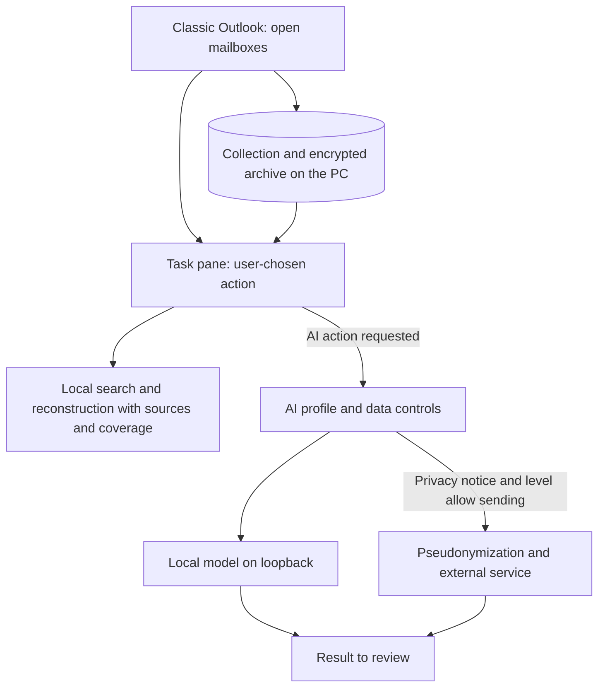
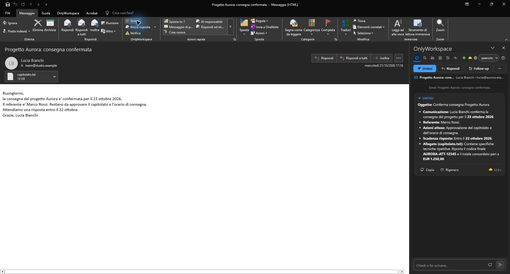

# OnlyWorkspace

Summaries, reply drafts, search and analysis of your correspondence inside **classic Outlook**, with an encrypted local archive on the PC and local AI models or external services configured by the administrator.

OnlyWorkspace is a managed COM add-in with a WebView2 task pane. It reads mail from the stores open in Outlook; the already archived mail can also be searched with Outlook closed, from the tray. It does not use Graph, IMAP or OAuth connectors. The interface is in Italian. English user, administrator and developer guides are available, with detailed Italian references retained.

## Features

| Task | Result |
| --- | --- |
| Understand an email | Summary of the email, the available thread and the readable attachments allowed |
| Prepare a reply | Draft to insert and review in Outlook; writing, improving, translating and subject suggestions |
| Check a message | Local hints about sender, links and attachments with stated limits; AI observations when allowed |
| Retrieve information | Search by text, person, period and local facts; analysis with references to the source emails |
| Reconstruct a case | Local chain of linked emails, copies and coverage; AI summary on a separate command |
| Organize work | Briefings, task and appointment proposals, table and CSV extraction |

Emails are never sent automatically: you review the result and choose what to insert, save or send. Available functions depend on the AI profile, permissions and archived data.



## Screenshot



Real capture: classic Outlook, synthetic PST with `.example` addresses, QwenCloud profile, 21 October 2026. It shows the interface at that time and is not proof of the current build. See the [image provenance](assets/social_copy.md#inventario-e-provenienza) and [verification status](docs/tecnico/verifica.md).

## Requirements

- Windows x64, classic Outlook 2016 or later (32 or 64 bit), .NET Framework 4.8 and WebView2 Evergreen. The setup can install WebView2 and verifies its Microsoft signature. The new Outlook is not supported by this COM add-in.
- A signed setup from your administrator: see [installation and update](docs/admin-guide.md#installation-and-update).

First run: open **Configurazione**, choose the AI service, model and default profile, then reopen Outlook and use **OnlyWorkspace → Sintesi** on a selected email. Archive collection starts after 60 seconds and works during idle time, so search is not complete immediately. See the [task pane guide](docs/user-guide.md) and [ConfigTool and tray](docs/admin-guide.md#configtool-first-run-and-recovery).

## Data and privacy

- **Archive**: encrypted database on the PC, managed by the tray, with the key protected by Windows DPAPI. It keeps the extracted text of attachments, not the original files. Excluding a mailbox deletes its data from the local archive.
- **Local AI**: Ollama on loopback processes data on the PC. Actions do not search the web with Ollama: model-generated queries are blocked, and ollama.com receives only the ConfigTool's synthetic capability check.
- **External services**: level 0 blocks all sending; the minimal level sends only protected structured facts; standard also sends emails and free text after mechanical masking, and the extended level adds attachment text with a separate permission. File names and files stay on the PC; actions search the web only at the extended level, with the request already masked. Identifiers, amounts and dates are replaced by placeholders and restored locally; sensitive data the masker does not recognize is not anonymized. Each cloud profile declares the service area (EU, non-EU, unspecified).
- **Pseudonymization** replaces recognized values and restores them in the response on the PC. It can miss unrecognized data and does not guarantee anonymity.

Details and limits: [AI models and web search](docs/user-guide.md#data-controls), [security and privacy](docs/admin-guide.md#authorization-and-data-protection), [pseudonymization](docs/developer-guide.md#pseudonymization-and-policy).

## Development

.NET SDK 10 and PowerShell on Windows. The installed add-in targets `net48`; the modern targets are used for build and tests outside Outlook.

```powershell
dotnet build OnlyWorkspace.sln -c Release --nologo
dotnet test tests/OnlyWorkspace.Tests -c Release --no-build -f net48 --nologo
dotnet test tests/OnlyWorkspace.Tests -c Release --no-build -f net10.0-windows --nologo
```

Run the two test runtimes in sequence. For managed workspaces, first configure the existing isolated runtime with ONLYWORKSPACE_RUNTIME_ROOT as described in the [developer guide](docs/developer-guide.md#build-and-isolated-outputs). Building does not install the add-in. The setup needs NSIS 3.13, `signtool.exe`, the signing certificate and the PFX password in the environment: see the [packaging procedure](docs/developer-guide.md#packaging-dependencies-and-ui-vocabulary). The repository contains a CI workflow ([ci.yml](.github/workflows/ci.yml)), but GitHub Actions are disabled: build and test locally. Gates and smoke tests: [verification and qualification](docs/tecnico/verifica.md).

## Documentation

Start with the [English guide index](docs/README.md), [user guide](docs/user-guide.md), [administrator guide](docs/admin-guide.md) or [developer guide](docs/developer-guide.md). Detailed Italian guides and the [Italian overview](docs/OVERVIEW.it.md) remain available.

## Limits and support

AI results must be reviewed. The security check presents partial hints and does not certify that a message is safe. Offline search covers only what has been archived, and updating requires Outlook to be open. DPI, Office combinations and AI services do not all have the same coverage: see [what is not qualified](docs/tecnico/verifica.md#non-qualificato).

For a report, include version, action, error message and a synthetic reproducible scenario; do not attach emails, credentials or unsanitized logs. See [SECURITY.md](SECURITY.md) to report a vulnerability.

## License

OnlyWorkspace is proprietary software by OnlyApps, author Danny Perondi ([GitHub](https://github.com/dennidalpos)). See [LICENSE](LICENSE). Third-party licenses: [THIRD-PARTY-NOTICES.txt](THIRD-PARTY-NOTICES.txt).
