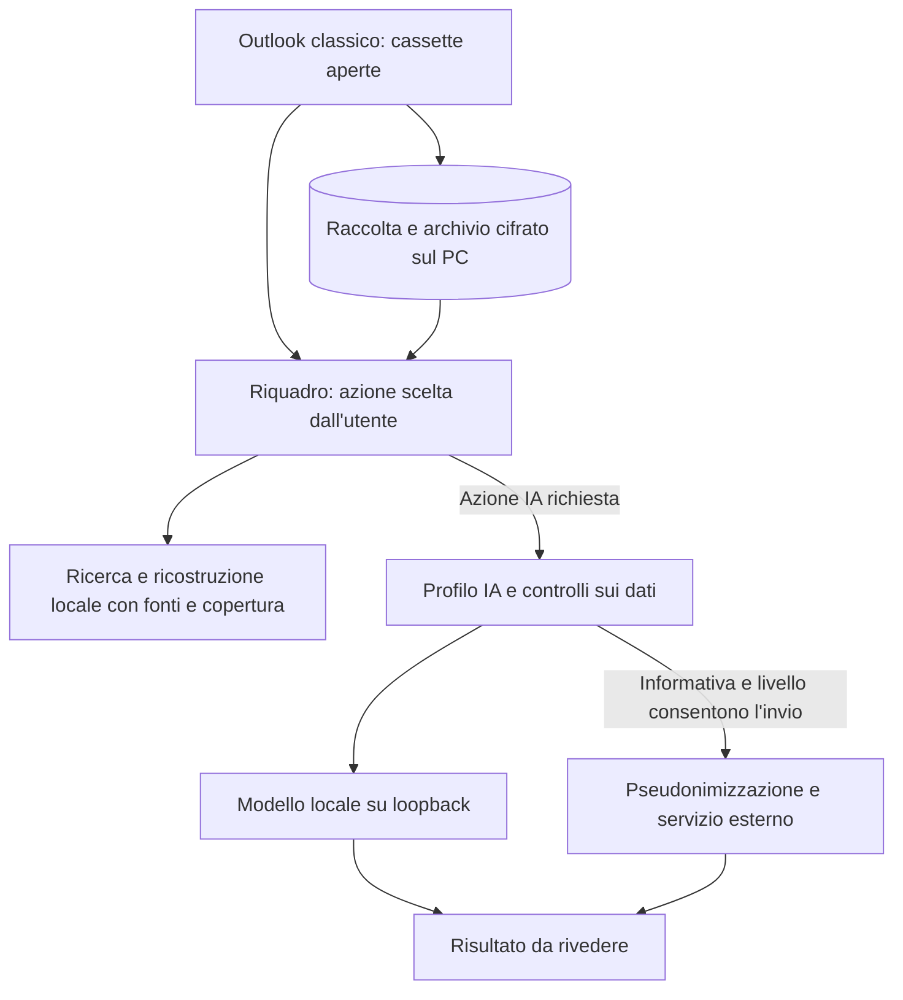
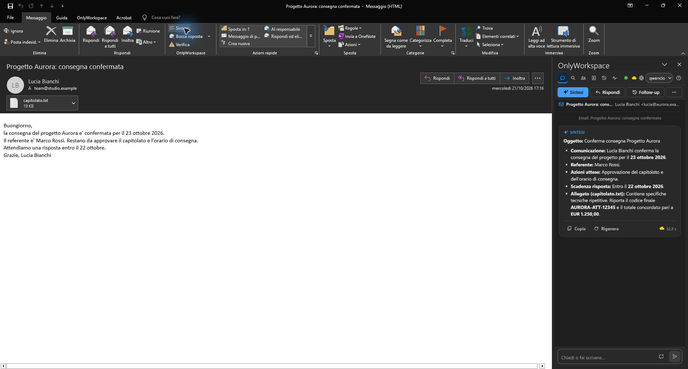

# OnlyWorkspace

Sintesi, bozze, ricerca e analisi della corrispondenza dentro **Outlook classico**, con un archivio cifrato sul PC e modelli IA locali o servizi esterni configurati dall'amministratore.

OnlyWorkspace è un add-in COM gestito con riquadro WebView2. Legge la posta dagli store aperti in Outlook; l'archivio già acquisito si può cercare anche a Outlook chiuso dalla tray. Non usa connettori Graph, IMAP o OAuth.

## Cosa puoi fare

| Compito | Risultato |
| --- | --- |
| Capire un'email | Sintesi dell'email, del thread disponibile e degli allegati leggibili consentiti |
| Preparare una risposta | Bozza da inserire e rivedere in Outlook; scrittura, miglioramento, traduzione e proposta dell'oggetto |
| Verificare un messaggio | Indizi locali su mittente, link e allegati, con limiti dichiarati; osservazioni IA quando consentite |
| Recuperare informazioni | Ricerca per testo, persona, periodo e fatti locali; analisi con riferimenti alle email di origine |
| Ricostruire una pratica | Catena locale di email collegate, copie e copertura; sintesi IA su comando separato |
| Organizzare il lavoro | Briefing, proposte di attività e appuntamenti, estrazione di tabelle e CSV |

Le email non vengono inviate automaticamente: controlli il risultato e scegli cosa inserire, salvare o inviare. Le funzioni disponibili dipendono dal profilo IA, dalle autorizzazioni e dai dati acquisiti.



## Uno sguardo al prodotto



Cattura reale già presente nel repository: Outlook classico, PST sintetico con indirizzi `.example`, profilo QwenCloud, 21 ottobre 2026. Mostra l'interfaccia di allora, precedente alle attuali restrizioni cloud sugli allegati; la versione esatta della build non è attestata nel corredo della cattura. [Provenienza delle immagini](../assets/social_copy.md#inventario-e-provenienza) e [stato delle verifiche](tecnico/verifica.md). Non rappresenta una prova della build corrente.

## Iniziare su un PC Windows

Servono **Windows x64**, **Outlook classico 2016 o successivo** a 32 o 64 bit, **.NET Framework 4.8** e **WebView2 Evergreen**. Il setup può installare WebView2 se manca, verificandone la firma Microsoft. Il nuovo Outlook non è supportato da questo add-in COM.

1. Ottieni dall'amministratore il setup firmato e chiudi Outlook. [Installazione e aggiornamento](admin/installazione.md) descrive prerequisiti, elevazione e conservazione dei dati.
2. Apri **Configurazione** e completa il primo avvio: scegli servizio IA, modello e profilo predefinito. Per un servizio esterno l'amministratore deve leggere e accettare l'informativa in **Privacy e dati** prima degli invii.
3. Controlla **Archivio email → Le mie cassette**: l'archivio, se abilitato, include inizialmente tutte le cassette, anche future. Escludere una cassetta elimina i suoi dati dall'archivio locale.
4. Riapri Outlook. Seleziona un'email e usa **OnlyWorkspace → Sintesi**, oppure apri **Chat** o **Cerca e analizza**. La raccolta dell'archivio parte dopo 60 secondi e lavora durante l'inattività: la ricerca non è subito completa.

La [guida del riquadro](utente/riquadro.md) spiega azioni, scorciatoie e interruzioni; [ConfigTool e tray](admin/configtool.md) descrive la configurazione.

## Dove vanno i dati

- **Archivio**: database cifrato sul PC, gestito dalla tray, con chiave protetta da DPAPI Windows. Conserva i testi acquisiti degli allegati, non i file allegati originali.
- **IA locale**: Ollama su loopback elabora sul PC. Con Ollama le azioni non cercano sul web: le query generate dal modello sono bloccate e ollama.com riceve solo la verifica sintetica del ConfigTool.
- **Servizi esterni**: il livello 0 blocca gli invii. Minimo ammette solo fatti strutturati protetti; Standard anche email e testo libero, già mascherati (identificativi, importi e date sostituiti da segnaposto, ripristinati sul PC); Esteso aggiunge il testo degli allegati con permesso distinto. Nomi dei file e file binari restano sul PC; le azioni cercano sul web solo a Esteso, con la richiesta già mascherata; i dati sensibili non riconosciuti dalla maschera non sono anonimizzati. Anche i modelli locali ricevono il testo con gli identificativi mascherati. Gli invii richiedono autorizzazione tecnica per servizio con informativa 8 e l'area del servizio (UE, non UE, non specificata), senza campi manuali.
- **Pseudonimizzazione**: sostituisce i valori riconosciuti e li ripristina nella risposta sul PC. Può lasciare dati non riconosciuti; non garantisce anonimato. Importi e date hanno opzioni separate, inizialmente disattivate.

Dettagli e limiti: [Modelli IA e Web Search](utente/modelli-web.md), [Sicurezza e privacy](admin/sicurezza.md), [Pseudonimizzazione](tecnico/pseudonimizzazione.md).

## Documentazione

[Indice delle guide](README.md#italian-reference-map). Per iniziare: [Riquadro](utente/riquadro.md) e [Installazione](admin/installazione.md).

Le guide descrivono il codice disponibile; le prove sulla build installata hanno una copertura distinta. Diagrammi di dettaglio: [percorsi utente](utente/guida-visiva.md) e [architettura](tecnico/architettura.md).

## Sviluppo

Il repository usa .NET SDK 10 e PowerShell su Windows. L'add-in installato usa `net48`; i target moderni servono a build e test fuori da Outlook. Da PowerShell nella radice del checkout:

```powershell
dotnet build OnlyWorkspace.sln -c Release --nologo
dotnet test tests/OnlyWorkspace.Tests -c Release --no-build -f net48 --nologo
dotnet test tests/OnlyWorkspace.Tests -c Release --no-build -f net10.0-windows --nologo
```

Esegui i due runtime in sequenza. La compilazione non installa l'add-in. Il setup richiede anche NSIS 3.13, `signtool.exe`, il certificato di firma e la password del PFX nell'ambiente: [procedura di packaging](admin/installazione.md#setup-firmato). Comandi eseguiti il 12/11/2026 su un clone pulito di c6fffef: build 0 avvisi, net48 2194/2194, net10 2195/2195, `test-scripts.ps1` 26 script, `check-code.ps1` OK. Non qualificano la build installata. Gate e smoke: [Verifica e qualifica](tecnico/verifica.md).

Controlli essenziali e formattazione circoscritta: [Analisi statica](tecnico/analisi-statica.md).

## Limiti e assistenza

I risultati IA vanno controllati. La Verifica sicurezza presenta indizi e controlli parziali, senza certificare che un messaggio sia sicuro. La ricerca offline copre soltanto ciò che è stato acquisito; l'aggiornamento richiede Outlook aperto. DPI, combinazioni Office e servizi IA non hanno tutti la stessa copertura: consulta [Verifica e qualifica](tecnico/verifica.md#non-qualificato).

Per un problema di configurazione parti da **Stato (Archivio e IA)** e dalle guide. Per una segnalazione al manutentore indica versione, azione, messaggio d'errore e uno scenario sintetico riproducibile; evita email, credenziali e log non sanificati.

## Licenza

OnlyWorkspace è software proprietario OnlyApps, autore Danny Perondi ([GitHub](https://github.com/dennidalpos)). Licenze delle dipendenze: [THIRD-PARTY-NOTICES.txt](../THIRD-PARTY-NOTICES.txt); i crediti sono nella pagina **Informazioni** della Configurazione.
