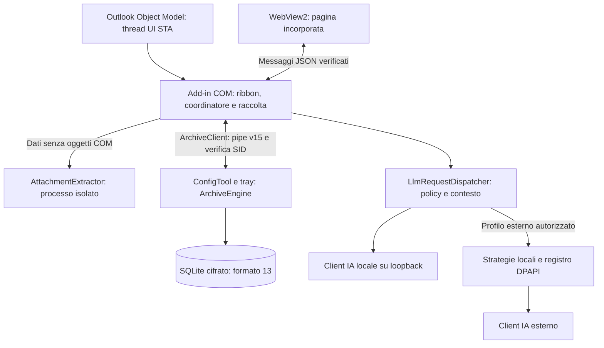

# Architettura

| Progetto | Compito | Target |
| --- | --- | --- |
| [Outlook](../../src/OnlyWorkspace.Outlook) | Add-in COM `IDTExtensibility2` (`OnlyWorkspace.Addin`), ribbon, riquadro WebView2, Outlook Object Model | `net48` AnyCPU |
| [Core](../../src/OnlyWorkspace.Core) | Modelli, prompt, query, validazione e regole senza COM | `net48`, `net10.0` |
| [Infrastructure](../../src/OnlyWorkspace.Infrastructure) | Client IA, configurazione, cifratura, motore e database dell'archivio | `net48`, `net10.0-windows` |
| [ConfigTool](../../src/OnlyWorkspace.ConfigTool) | GUI, CLI e tray; ospita il motore dell'archivio | `net48`, `net10.0-windows` |
| [AttachmentExtractor](../../src/OnlyWorkspace.AttachmentExtractor) | Lettura dei documenti in un processo separato | `net48` |

Il setup installa la build `net48`; i target moderni servono a build e test fuori da Outlook. La versione è in [Directory.Build.props](../../Directory.Build.props). Outlook e Word usano tipi Interop incorporati (No-PIA); il packaging verifica l'assenza di riferimenti runtime prima di escludere le DLL Interop. Dettagli in [Dipendenze](dipendenze.md).

## Orientarsi nel codice

I file parziali compongono lo stesso tipo ([Microsoft](https://learn.microsoft.com/en-us/dotnet/csharp/programming-guide/classes-and-structs/partial-classes-and-methods)). Per coordinatore e form, partire dal file principale per stato, ciclo di vita e collegamenti; seguire poi il file della funzione interessata.

| Area | File e responsabilità |
| --- | --- |
| Risposte strutturate | [ModelOutput](../../src/OnlyWorkspace.Core/Agents/ModelOutput.cs): struttura della risposta e stringhe del modello; i parser mantengono le proprie regole per numeri, date e testo del riquadro. |
| Endpoint IA | [LlmEndpoint](../../src/OnlyWorkspace.Infrastructure/Llm/LlmEndpoint.cs): prefisso relativo v1, senza inizializzare il trasporto; [LlmHttp](../../src/OnlyWorkspace.Infrastructure/Llm/LlmHttp.cs): HTTP, TLS, errori e lettura del flusso. |
| Conversazioni | [TaskPaneCoordinator.Chat](../../src/OnlyWorkspace.Outlook/UI/TaskPaneCoordinator.Chat.cs): Chat, contesto dei messaggi e storico della conversazione. |
| Appuntamenti e scadenze | [TaskPaneCoordinator.Calendar](../../src/OnlyWorkspace.Outlook/UI/TaskPaneCoordinator.Calendar.cs): scansione, verifica delle fonti e salvataggio degli elementi scelti. |
| Pagina profili | [MainConfigForm.ProfilePage](../../src/OnlyWorkspace.ConfigTool/Forms/MainConfigForm.ProfilePage.cs): costruzione dei controlli della pagina. |
| Modifica dei profili | [MainConfigForm.Profiles](../../src/OnlyWorkspace.ConfigTool/Forms/MainConfigForm.Profiles.cs): selezione, campi, budget, modelli e verifiche; [Capabilities](../../src/OnlyWorkspace.ConfigTool/Forms/MainConfigForm.Capabilities.cs): comandi di Avanzate. |

Campi e inizializzatori di coordinatore e form restano nelle parti originarie; i nuovi file parziali raccolgono i metodi per responsabilità.

## Confini

Il diagramma segue i componenti nei progetti e i confini descritti sotto; la presenza di un collegamento non autorizza da sola il trasferimento dei dati.

- **Thread di Outlook**: [OutlookDataService](../../src/OnlyWorkspace.Outlook/Services/OutlookDataService.cs) usa l'Object Model solo sul thread UI STA ([Microsoft](https://learn.microsoft.com/en-us/office/client-developer/outlook/selecting-an-api-or-technology-for-developing-solutions-for-outlook)). [ArchiveIndexer](../../src/OnlyWorkspace.Outlook/Services/ArchiveIndexer.cs) legge a fette di 40 ms quando l'utente è inattivo e cede durante le azioni interattive; nessun oggetto COM passa ai thread di rete o disco.
- **Riquadro**: [TaskPaneCoordinator](../../src/OnlyWorkspace.Outlook/UI/TaskPaneCoordinator.cs) riceve messaggi JSON da WebView2 e avvia il lavoro asincrono. Il riquadro accetta una sola navigazione dell'host (l'HTML incorporato) e scarta i messaggi la cui sorgente non è `about:blank`. [TaskPaneManager](../../src/OnlyWorkspace.Outlook/Services/TaskPaneManager.cs) crea un riquadro per finestra e lo rilascia alla chiusura.
- **Archivio**: [ArchiveEngine](../../src/OnlyWorkspace.Infrastructure/Archive/ArchiveEngine.cs), nella tray, è l'unico proprietario dei database. Add-in e finestra di ricerca usano [ArchiveClient](../../src/OnlyWorkspace.Infrastructure/Archive/ArchiveClient.cs) su named pipe con verifica del SID; una lease ammette un solo raccoglitore Outlook per profilo. Dettagli: [Motore dell'archivio](archivio-motore.md).
- **Allegati**: testo estratto da un eseguibile isolato con timeout e limite di memoria ([Allegati](allegati.md)).
- **Fatti locali**: estrattore deterministico in Core, persistenza cifrata con fonti/posizioni e coda riprendibile nel motore tray. Il formato è 13, la pipe è v15; importi, scadenze e riferimenti filtrano le ricerche locali; trigrammi e catene collegano thread anche per riferimenti condivisi, con una voce per Message-ID e posizioni delle copie conservate. Il recupero non usa IA. I dati PEC `facts-only` restano esclusi dai prompt e da FTS ([contratto](archivio-motore.md#fatti-locali)).
- **IA**: un client per famiglia di protocollo (Ollama, OpenAI, Anthropic, Gemini); il [catalogo](../../src/OnlyWorkspace.Core/Models/ProviderCatalog.cs) instrada i 20 connettori. Il profilo decide endpoint, invio dei dati, testo degli allegati e Web Search.
- **Esposizione dei dati**: `ExposurePolicy` definisce Solo locale, Minimo, Standard ed Esteso per i profili esterni. Esteso aggiunge il testo degli allegati estratto localmente, con permesso distinto e pseudonimizzazione; web come Standard. I vecchi Full/3 passano a Standard al caricamento, mentre Esteso usa il valore enum 4. L’informativa v4 richiede accettazione; la policy conversazione revisione 5 separa i nuovi contesti da quelli precedenti, che restano consultabili. Strategie, identità locali e registro DPAPI sono descritti in [Pseudonimizzazione](pseudonimizzazione.md).
- **Esito IA**: `ILlmClient.LastCompletion` separa motivo di fine e troncamento da `LastTokenUsage`. OpenAI-compatible conserva `finish_reason=length` anche senza `usage`; Gemini conserva `MAX_TOKENS`, Anthropic `max_tokens` e `model_context_window_exceeded`, per SSE e JSON. Le quattro famiglie di client espongono i consumi solo dopo aver osservato sia input sia output come interi non negativi; i frammenti cumulativi si aggiornano senza azzerare i campi mancanti. In Anthropic l'output iniziale di `message_start` non sostituisce quello di `message_delta`. Parser e riquadro rifiutano o segnalano l'incompletezza: una risposta strutturata troncata è rifiutata senza continuazioni, il testo in streaming segnala il troncamento. Contratti: [OpenAI streaming](https://developers.openai.com/api/reference/resources/chat/subresources/completions/streaming-events), [Gemini](https://ai.google.dev/api/generate-content), [Anthropic](https://platform.claude.com/docs/en/build-with-claude/streaming). Per Ollama vale anche il [contratto dei contatori chat](https://docs.ollama.com/api/chat). Fixture e harness net48 non certificano i servizi reali.
- **Risposta su più email**: chat, Cerca e analizza, domande successive e `FollowUpCoordinator` usano `MailEvidencePack`: email numerate [Mn] dalla più vecchia alla più recente. `MailEvidenceReader` legge fatti locali a Minimo oppure originali interi ripuliti a Standard e con profili locali, senza schede IA pregresse; le fonti mancanti o escluse per budget sono dichiarate. Una sola richiesta strutturata (`mail.answer`, `mail.table`, `followup.status`); `MailAnswerVerifier` cerca importi, date e codici di ogni punto nell'email citata con le normalizzazioni dei fatti d'archivio e marca quelli non verificati. `MailAnswerRenderer` scrive punti, limiti e copertura. Elenco e conteggio (`MailRequest`) finiscono con l'elenco locale; una risposta strutturata troncata è rifiutata, senza continuazioni. Appuntamenti e scadenze usa le candidate selezionate localmente e una richiesta `calendar.scan`: fatti Date/Deadline con provenienza a Minimo, originali ripuliti e fatti negli altri profili. Ogni voce porta `source` [Mn] e `date_text`, che il verificatore confronta con l'email citata e le date esplicite; fonte e note d'origine vengono dal pacchetto, le voci non verificate restano non preselezionate.
- **Ricostruisci la pratica**: preset locale di Cerca e analizza dall’email scelta, con catena cronologica, copie, fonti e copertura; sintesi IA soltanto su comando esplicito. Nessuno stato o chiusura persistita.
- **Stop dell'analisi**: Interrompi durante la lettura o la richiesta finale (`AnalysisFinalization`) conserva l'elenco già mostrato con l'indicazione «Analisi interrotta prima della risposta finale», senza altre richieste. Il reset interno della conversazione, lo storico, un turno sostitutivo e la chiusura scartano il risultato; il comando utente Svuota chat è rifiutato finché il lavoro non termina.
- **Dispatch IA**: `IsExternal` deriva anche dal destinatario non loopback; `LlmHttp` rifiuta tutti i redirect. `ModelRequestContext` misura messaggi, schema e strumenti senza modificarli; il riquadro usa `LlmRequestDispatcher` per controllare contesto e validità della policy prima dell'invio e dei risultati tardivi. `ConversationPolicy` lega il nuovo storico alla policy di profilo; quello sconosciuto o diverso resta consultabile e prosegue in una chat separata.
- **Prompt**: file JSON in [prompts](../../prompts), copiati accanto alle DLL (installazione, build e test) e caricati da [PromptCatalog](../../src/OnlyWorkspace.Core/Prompts/PromptCatalog.cs); un prompt mancante ferma l'azione, non esiste una copia nel codice. La struttura adottata è descritta qui sotto.

## Prompt

Struttura CO-STAR adattata, condivisa tra provider: nel messaggio di sistema fisso Contesto, Compito, Regole e Formato della risposta, più Stile e tono e Destinatario dove servono; nel messaggio utente prima i dati tra tag (`<email>`, `<note>`…), poi il compito ripetuto in fondo. I contenuti ricevuti restano dati non attendibili. Le regole comuni sono in `fragments.json` (`{{nome}}`); data di oggi e valori variabili stanno nel messaggio utente. `dati` chiede di non eseguire le richieste contenute nei dati, ma di riportarle come contenuto; `fedelta` aggiunge soggetti e condizioni espliciti, negazioni sul verbo originale, richieste e promesse che non diventano azioni compiute e dati in contrasto dichiarati (frammenti 54). La Verifica sicurezza (`security` 4) chiede osservazioni citate per categoria, senza gravità; il contesto dei controlli dell'app viaggia nel blocco `<contesto>` e non è citabile. Testi per l'utente in italiano o nella lingua della domanda; bozze e traduzioni nella lingua dell'email o richiesta.

I template del generatore automatico sono stati ritirati. Il banco corrente misura soltanto i fatti locali; le precedenti qualifiche IA restano nelle ricevute storiche. Le modifiche ai prompt attivi richiedono verifiche proporzionate alla funzione e al modello, senza dedurre una qualifica universale dal solo schema.

L’intento della chat è classificato da regole locali (`IntentClassifier.ClassifyLocal`), senza trasmettere la domanda a un modello. I parser conservano periodi, mittenti, nomi, termini citati e codici; gli indizi non riconosciuti restano nella ricerca. Il Briefing usa gli originali ripuliti nei permessi del profilo, oppure fatti locali al livello Minimo. Appuntamenti e scadenze a Minimo prepara il pacchetto dai fatti locali delle copie consentite senza leggere gli originali (A214). Non leggono schede IA pregresse. Il Briefing Minimo mostra l’agenda soltanto in locale: `BriefingContext.AgendaForModel` la esclude prima del prompt, mentre `HistoryChatMessage.ModelContent` conserva il solo contesto riutilizzabile separatamente da `Content`, che resta completo per la visualizzazione. Un valore vuoto esclude il messaggio dal contesto; un valore assente usa il testo normale. La policy conversazione revisione 5 impedisce il riuso implicito degli storici precedenti. Il filtro di copie esatte `ArchiveQuery.EmailRefs` è combinato con le cassette consentite sulla pipe v15; il formato del database è 13.
