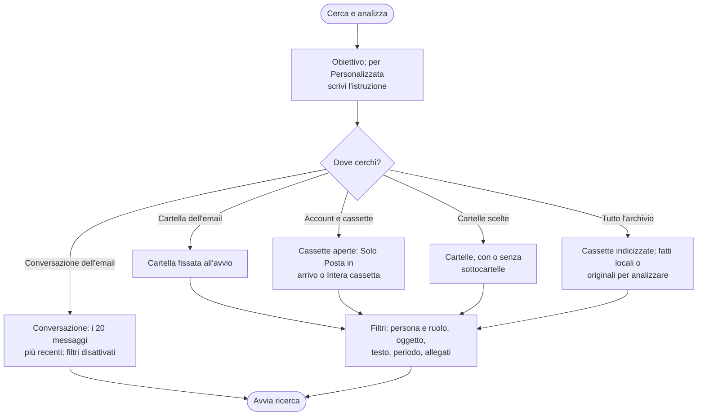

# Cerca e analizza

Si apre da **Posta → Cerca e analizza** nel riquadro o da **OnlyWorkspace → Cerca e analizza**, inizialmente su **Account e cassette** e senza filtri ricavati dall'email selezionata.

## Obiettivo, ambito e filtri

| Obiettivo | Risultato |
| --- | --- |
| **Riepilogo**, **Punti aperti**, **Personalizzata** | Testo dall'analisi IA delle email trovate |
| **Tabella dati** | Righe con riferimenti alle email; Copia o Salva CSV |
| **Appuntamenti e scadenze** | Voci selezionabili da aggiungere a Outlook |
| **Ricostruisci la pratica** | Catena locale dall’email selezionata, con copie e copertura; **Genera sintesi** avvia separatamente l’IA |
| **Email senza risposta** | Elenco locale della Posta inviata e bozza di sollecito |

- **Persona** vuoto comprende tutti. Il ruolo distingue mittente, destinatario o entrambi. Fuori dall'archivio più valori separati da virgola o punto e virgola valgono in alternativa e il destinatario si confronta con i nomi mostrati da Outlook in A/Cc: un indirizzo può non corrispondere. `*` e `?` sono jolly.
- Aperta da una **controparte**, la ricerca comprende tutti gli indirizzi del gruppo; **Rimuovi controparte** toglie il vincolo.
- **Intera cassetta** esclude Posta eliminata, Posta indesiderata, Bozze e Posta in uscita.
- **Conversazione dell'email selezionata** mostra l'oggetto dell'email che userà e legge al massimo i 20 messaggi più recenti della conversazione Outlook; se ne ha di più, il risultato dice quanti ne ha e quanti dei più vecchi sono esclusi. Richiede un'email selezionata o aperta in lettura, come l'ambito **Cartella dell'email**; una bozza in scrittura, anche inline, non fornisce questo contesto. **Account e cassette**, **Cartelle scelte** e **Tutto l'archivio** restano utilizzabili senza selezione.
- La ricerca arriva sempre alla fine dell'ambito; l'analisi legge al massimo le email più recenti indicate da `limits.maxAnalysisEmails` (default 300) e il risultato dichiara quante altre ne ha trovate.

## Fatti e catena locale nell'archivio

Su **Tutto l'archivio**, il campo **Fatti** combina riferimenti, importi e scadenze, per esempio `ordine ORD-2026/118; importo >=1000,01 EUR; scadenza entro 2026-11-30`. Usa importi con valuta e date `AAAA-MM-GG`; `>=` e `<=` includono l'estremo, senza operatore l'importo è esatto. Un filtro ambiguo o non riconosciuto ferma la richiesta con un avviso, senza allargarla a tutte le email. Non ci sono conversioni di valuta; la ricerca dipende dai fatti già estratti e dichiara la copertura incompleta.

Il PC seleziona i risultati con i filtri, poi ricostruisce le catene tramite intestazioni e riferimenti condivisi. I correlati possono essere fuori periodo o mittente: sono indicati come **correlati fuori filtro**, con il motivo. Le cassette consentite e la policy degli allegati restano vincolanti. Una sola copia per Message-ID, dalla più vecchia alla più recente secondo invio, altrimenti ricezione. Questa fase non chiama il modello.

**Ricostruisci la pratica** richiede un’email selezionata o aperta in lettura e l’archivio attivo. Mostra l’oggetto dell’email di partenza, poi email collegate, copie, possibili collegamenti e lacune di copertura dentro Cerca e analizza, senza chiamare l’IA. Funziona anche senza un profilo IA configurato. **Genera sintesi** è un comando separato che analizza la stessa catena con il profilo e i permessi correnti. Non vengono calcolati stati delle pratiche né salvate chiusure. [Dettagli della ricostruzione](archivio.md#ricostruisci-la-pratica-e-sintesi).

## Analisi delle email trovate

1. Il PC cerca nell'ambito; senza candidate mostra «Nessuna candidata trovata» con la copertura.
2. L'elenco delle email trovate compare subito, dalla più vecchia alla più recente, senza chiamare il modello. Se l'indicazione libera chiede solo un elenco o un conteggio («elenca le email…», «quante mail…»), l'analisi finisce qui.
3. Ogni email entra nella richiesta tramite fatti locali al livello Minimo oppure tramite originali ripuliti a Standard e con profili locali, con gli allegati richiesti e consentiti. Su «Tutto l’archivio» una sola copia per Message-ID.
4. Un'unica richiesta al modello legge tutte le email, numerate [M1], [M2]… in ordine cronologico, e restituisce una risposta strutturata in cui ogni punto cita le sue email. La **Tabella dati** sceglie le colonne e compila le righe nella stessa richiesta, ognuna con la sua email.
5. Il PC cerca importi, date e riferimenti di ogni punto nel testo dell'email citata: quelli che non trova sono marcati «non verificato», un punto senza fonte valida è segnalato. La riga **Copertura** dice quante email sono state lette dagli originali o dai fatti locali, quante sono citate e quanti punti non sono verificati.
6. Con Ollama un'email che da sola non entra nel contesto viene esclusa e dichiarata; se l'insieme non entra, la richiesta si ferma con un messaggio e senza risultato parziale. Con i cloud i limiti sono del provider.
7. Il risultato indica email esaminate, candidate, lette, citate, escluse e parti non disponibili, e va nello storico con le fonti [Mn]. Una domanda sull'analisi rilegge le stesse email in una nuova richiesta, finché restano disponibili.

Interrompi durante la lettura o durante la richiesta finale chiude con l'elenco delle email trovate («Analisi interrotta prima della risposta finale»), senza altre richieste; premuto più volte salva un solo risultato parziale. Una ricerca web fallita non annulla l'analisi: la risposta lo dichiara. Svuota chat rimane indisponibile durante il lavoro. Aprire un’altra conversazione, avviare una nuova operazione o chiudere la finestra annulla invece il turno precedente.

Un PDF con una pagina scansionata o con testo insufficiente è dichiarato non letto per intero anche quando le altre pagine hanno testo. Le pagine scansionate e le immagini sono lette con l'OCR di Windows quando l'amministratore lo lascia acceso ([Allegati](../tecnico/allegati.md#ocr-e8)); una pagina non riconosciuta lascia non letto l'intero documento. Le prove datate sono in [Verifica e qualifica](../tecnico/verifica.md).

## Appuntamenti e scadenze

Le candidate vengono filtrate localmente per incontri e scadenze prima dell'IA. Al livello **Minimo** la scansione usa soltanto i fatti estratti nell'archivio locale: prepara il pacchetto senza leggere corpi, PEC o allegati, anche se già caricati dalla selezione della conversazione e segnala le email senza fatti utilizzabili. Al modello arrivano i fatti con il numero e la data dell'email; oggetto, mittente e motivi di correlazione restano sul PC, anche nelle domande successive allo Storico. Con **Standard** o un profilo locale usa il testo originale ripulito e i fatti; gli allegati si includono con la spunta solo se consentiti dal profilo. Le schede IA pregresse non sono usate.

Le candidate entrano in **una sola richiesta**. Un'email troppo lunga per il profilo resta fuori intera ed è dichiarata. La ricerca web, quando consentita dal profilo e dal livello, usa solo i domini aziendali dei mittenti e mostra riferimenti separati («Ricerca web non riuscita» se fallisce). Le voci già presenti in Outlook sono segnalate e non preselezionate. **Aggiungi voci selezionate** salva con categoria «OnlyWorkspace»; **Copia elenco** e **Salva CSV in Download** esportano senza salvare. Ogni voce mostra l'email di origine ([Mn], oggetto e data, apribile in Outlook con un clic; anche nelle note e negli export) e le parole con cui quell'email scrive la data: le date relative («venerdì») sono risolte sulla data dell'email che le contiene. Il codice cerca quelle parole nei dati inviati dell'email citata e controlla che una data esplicita coincida con quella della voce; le voci non verificate restano in elenco con l'avviso, non preselezionate, e tra due doppioni resta quello verificato. Interrompi durante la richiesta lo dichiara: i dati risultano inviati al modello, senza voci ricevute. Gli scarti di validazione sono conteggiati e dichiarati nel risultato, nello storico e negli export. I filtri su date certe e future e il raggruppamento delle voci restano intenzionali.

## Email senza risposta

Cerca nella **Posta inviata delle cassette scelte** (non usa conversazione, cartella o archivio) le email senza risposta da almeno N giorni (default 5, configurabile 1-30), entro gli ultimi 365 giorni. L'elenco è locale, senza IA, ed esportabile. **Bozza sollecito** invia al modello solo il messaggio scelto, senza allegati, e apre il sollecito in Outlook da rivedere e inviare.

Codice: [TaskPane.html](../../src/OnlyWorkspace.Outlook/UI/TaskPane.html), [TaskPaneCoordinator.Analysis](../../src/OnlyWorkspace.Outlook/UI/TaskPaneCoordinator.Analysis.cs), [MailAnalysis](../../src/OnlyWorkspace.Core/Agents/MailAnalysis.cs).
