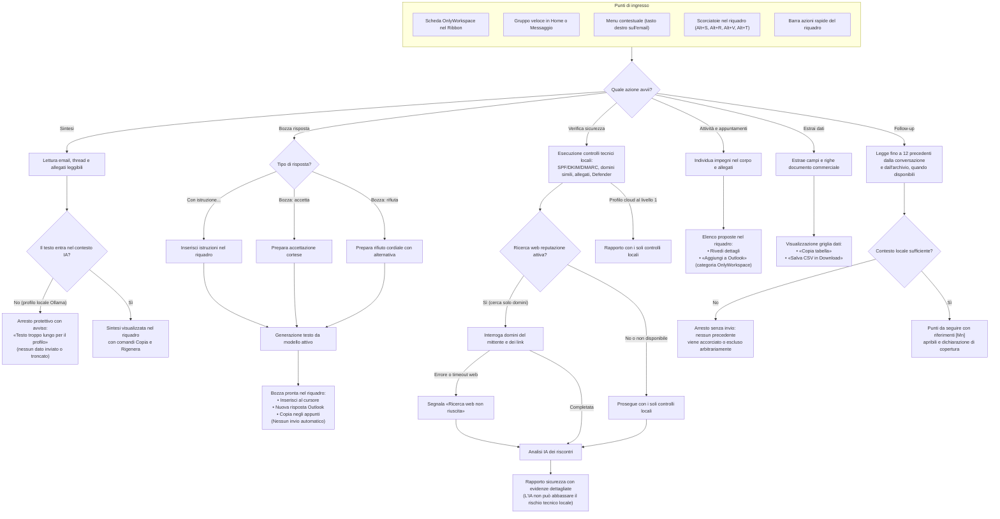
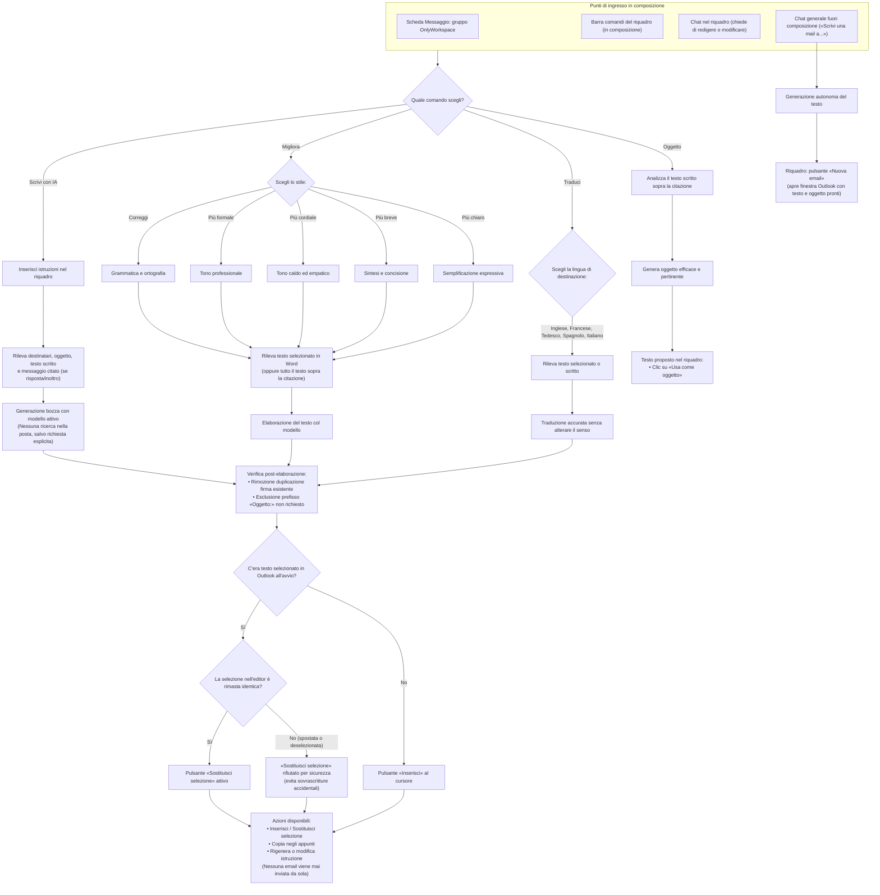
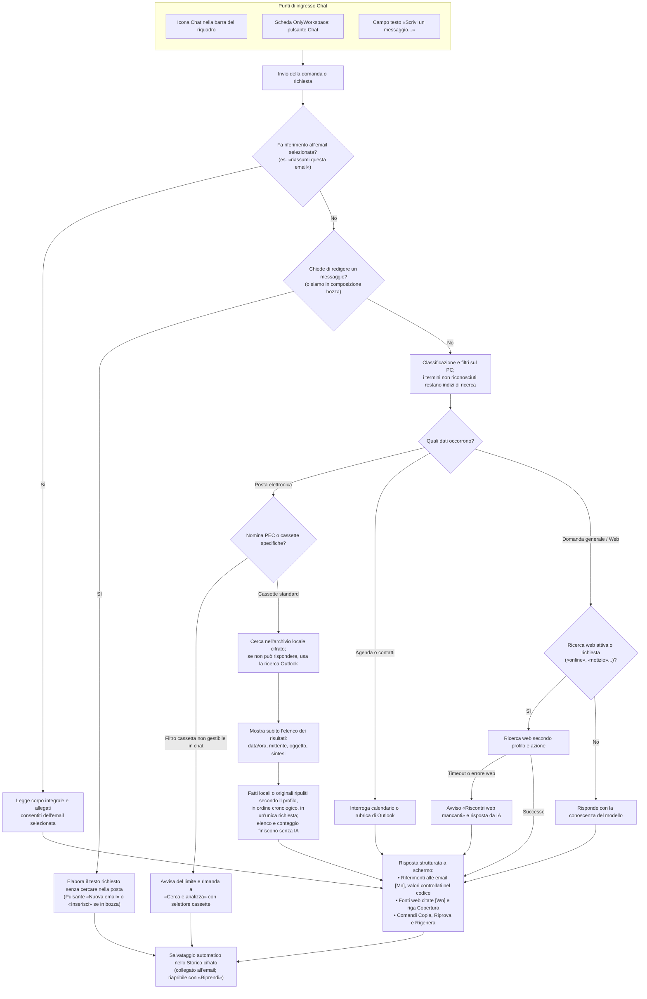
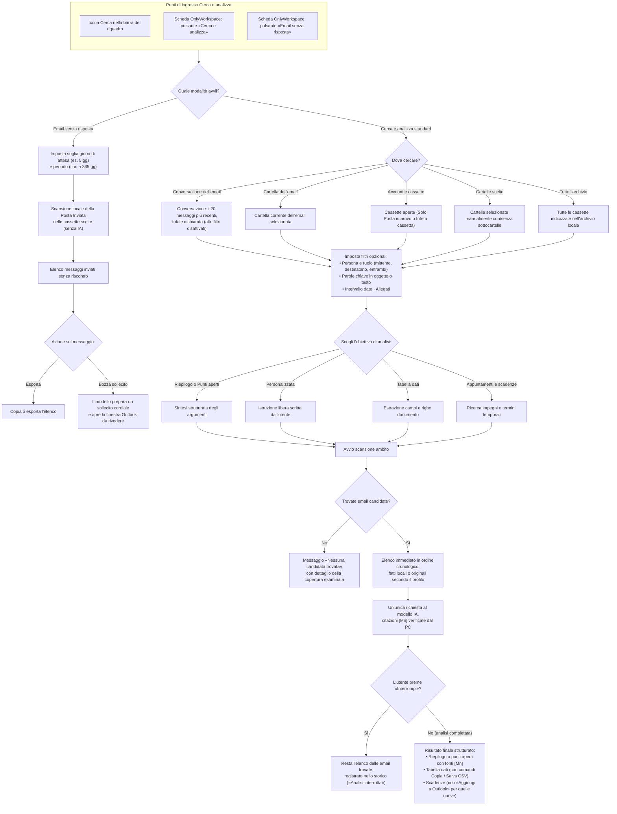
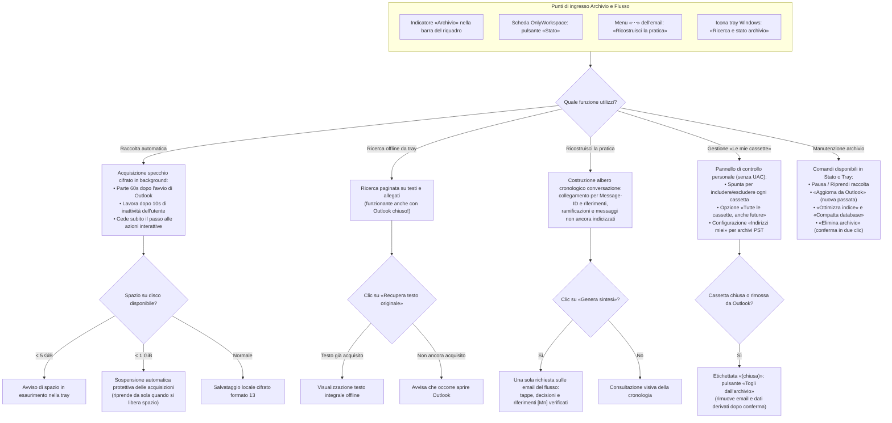
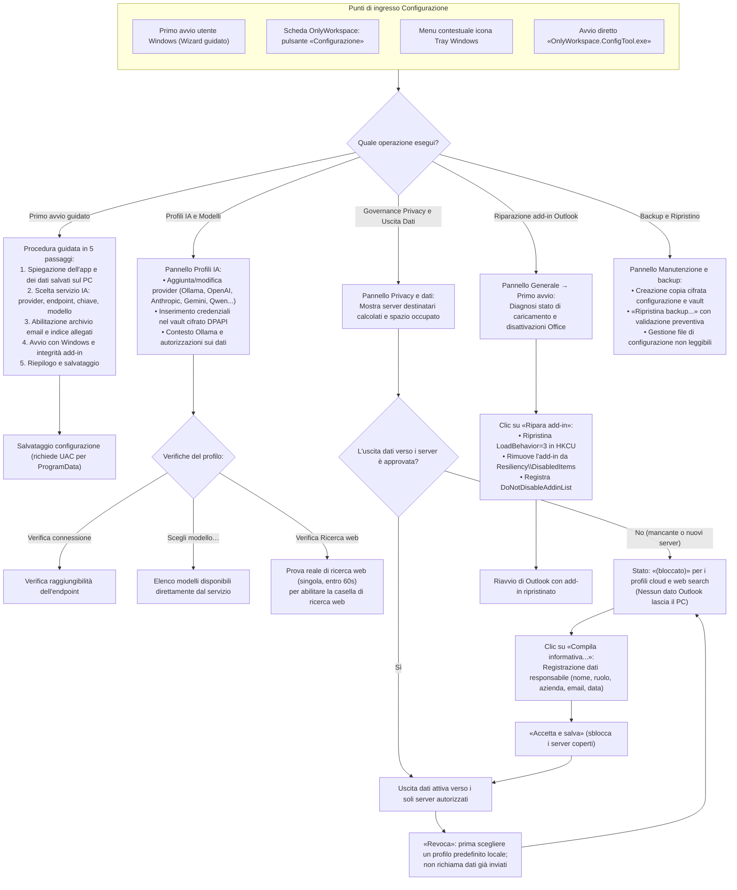

# Guida visiva ai percorsi utente

Guida dei principali percorsi, riallineata staticamente al codice il 01/11/2026. Questa revisione non è una nuova prova installata; evidenze e limiti sono in [Verifica e qualifica](../tecnico/verifica.md). Il [kit social](../../assets/social_copy.md) distingue catture datate e illustrazioni.
Ciascuna sezione descrive un'area funzionale tramite un diagramma Mermaid orientato all'esperienza dell'utente finale, indicando:
- **Punti di ingresso**: ribbon, menu contestuali, riquadro WebView2, finestra di composizione o icona nella tray.
- **Azioni e scelte**: opzioni disponibili prima e durante l'esecuzione.
- **Bivi decisionali**: controlli locali, vincoli di contesto, verifiche e opzioni di salvataggio.
- **Risultati ed esiti operativi**: bozze e tabelle (sempre su conferma o espliciti: nessun invio automatico di email).
- **Percorsi di errore o recupero**: superamento contesto locale, assenza di riscontri web, interruzioni parziali e blocchi di sicurezza.

---

## 1. Azioni sull'email selezionata

Quando selezioni un'email nell'elenco di Outlook o la apri in una finestra di lettura, puoi avviare le azioni rapide dedicate dal Ribbon, dal menu contestuale o dal riquadro.
Il modello riceve i testi interi puliti necessari all’azione e gli allegati consentiti e leggibili per intero; quelli esclusi o incompleti sono dichiarati. La richiesta locale completa, inclusi prompt e schema, deve rientrare nel contesto. La ricerca web ha un invio distinto e limitato, descritto in [Sicurezza e dati](../admin/sicurezza.md).

Tutti i percorsi IA restano soggetti al profilo: i livelli esterni correnti escludono il testo degli allegati; Minimo consente i soli fatti locali nelle azioni previste, Standard anche gli originali ripuliti. Il web esterno è limitato alla Verifica sicurezza a Standard. [Autorizzazioni e limiti](modelli-web.md).

---

## 2. Scrittura e composizione

Nelle finestre di composizione (Nuova email, Risposta o Inoltro), il riquadro offre strumenti di supporto alla stesura. Il testo in lavorazione non è trattato come "email selezionata": non cerca nella posta né sul web se non espressamente richiesto.
La funzione di sostituzione della selezione protegge l'utente: se il cursore o la selezione cambiano durante la generazione, la sostituzione viene bloccata per evitare sovrascritture accidentali.

---

## 3. Chat nel riquadro e ricerca assistita

La chat assistente risponde a domande sulla posta, sull'agenda o generali.
L'intento viene classificato sul PC; la risposta può comunque richiedere il modello. Chat e Cerca e analizza mostrano subito l'elenco delle email trovate; un elenco o un conteggio finisce lì. Altrimenti un'unica richiesta legge fatti locali a Minimo oppure originali ripuliti a Standard e con profili locali, in ordine cronologico. Ogni punto cita le sue email [Mn]: importi, date e riferimenti non trovati nell'email citata sono marcati «non verificato». Le schede IA pregresse non alimentano la richiesta e non vengono generate automaticamente.

---

## 4. Cerca e analizza

Questa schermata consente di impostare ricerche mirate su uno specifico perimetro (conversazione, cartella, cassette o intero archivio) ed eseguire analisi avanzate o estrazioni di tabelle e scadenze. Include inoltre la modalità speciale **Email senza risposta**, dedicata a monitorare la posta inviata e preparare solleciti.

Il diagramma riassume le analisi della posta. Per **Appuntamenti e scadenze** la selezione è locale e la richiesta usa i soli fatti locali a Minimo oppure originali ripuliti e fatti a Standard o con un profilo locale; se viene interrotta, resta un riepilogo della lettura, non l'elenco descritto per le altre analisi. Dettagli: [Appuntamenti e scadenze](cerca-analizza.md#appuntamenti-e-scadenze).

---

## 5. Archivio locale, ricostruisci flusso e manutenzione

L'archivio è uno specchio cifrato locale della posta acquisita da Outlook.
Consente la ricerca offline e il recupero del testo integrale anche a Outlook chiuso, la ricostruzione della cronologia dei thread con le loro ramificazioni e la gestione autonoma per-utente delle cassette senza privilegi amministrativi.

---

## 6. ConfigTool, primo avvio e governance privacy

La finestra ConfigTool gestisce la configurazione dell'add-in e la tutela dei dati.
Nessun dato di Outlook esce verso server esterni finché un responsabile non accetta l'informativa in **Privacy e dati** (*Data Egress Gate*). In caso di problemi di avvio con Outlook, il comando **Ripara add-in** ripristina la registrazione dell'utente senza reinstallare.

---

## Controlli e limiti sui dati

| Principio | Comportamento |
|---|---|
| **Nessun invio automatico** | Bozze, solleciti e risposte vengono sempre mostrati all'utente o aperti in Outlook per la revisione prima dell'invio. |
| **Modifiche esplicite** | Le proposte per calendario e attività vengono salvate con un’azione dell’utente. La Chat può cercare contatti Outlook; non esiste un flusso di scrittura della rubrica. |
| **Protezione contesto locale** | Se il testo supera il limite con Ollama, l'azione si ferma con un messaggio chiaro anziché inviare estratti mozzati. |
| **Governance uscita dati** | Gli invii di dati Outlook a servizi esterni richiedono l’informativa accettata per le destinazioni, anche per il web con Ollama locale. Le prove di connessione usano dati sintetici. |
| **Ricerca web non disponibile** | L'azione può proseguire senza riscontri web e ne segnala l'assenza; il modello configurato può comunque richiedere una connessione. |

L’archivio cifrato locale non rende locale un’elaborazione cloud. Solo l’inferenza su loopback senza web può lavorare offline; uso e conservazione dei dati esterni dipendono dal contratto/piano del provider. Vedere [Sicurezza e dati](../admin/sicurezza.md). Le keytip del ribbon sono distinte dalle scorciatoie del riquadro (per esempio B per Bozza risposta nel ribbon, Alt+R nel riquadro).
