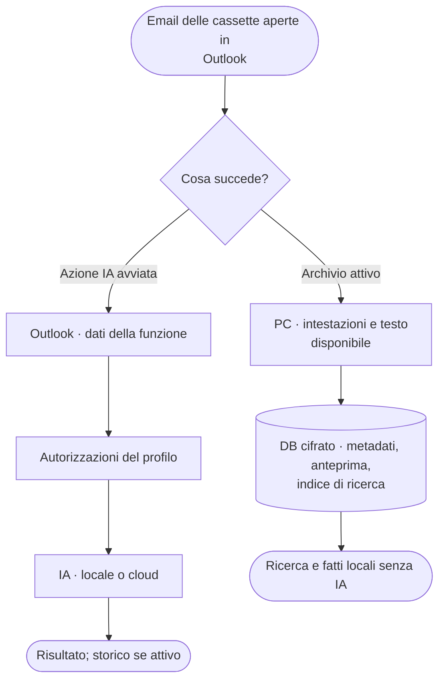

# Modelli IA e Ricerca web

Se una domanda sulla posta chiede esplicitamente anche il web, per esempio «cerca online», la risposta non termina con i soli fatti locali: prosegue nel percorso del modello e della ricerca web, secondo le autorizzazioni del profilo. Senza questa richiesta esplicita, una domanda risolvibile dai fatti locali continua a ricevere una risposta locale.

## Chi riceve i dati

Il riquadro usa il profilo predefinito scelto dall'amministratore nel ConfigTool. Il suggerimento sul nome OnlyWorkspace nella barra mostra profilo, modello e server, la destinazione «Cloud» dell'indicatore IA distingue il cloud e il globo indica le azioni con Ricerca web. Un profilo cloud usa le autorizzazioni già configurate per le azioni avviate: il riquadro non chiede conferme. Prima serve che un responsabile accetti l'informativa sull'uscita dei dati nel ConfigTool (**Privacy e dati**): finché manca, o se il servizio non è tra quelli accettati, il riquadro mostra «Profilo cloud bloccato» e non invia nulla; la ricerca web verso quei server viene saltata con una nota. Un nuovo server, un livello di esposizione più alto o una nuova versione dell'informativa richiedono una nuova accettazione. Un errore di Ollama non passa mai da solo a un profilo cloud.

Ogni profilo cloud ha un **livello di esposizione**: al livello 0 · Solo locale il profilo esterno non invia nulla; al livello 1 · Minimo escono solo fatti estratti in locale, con nomi, indirizzi, telefoni e codici sostituiti da segnaposto; al livello 2 · Standard anche il testo ripulito dell'email, sempre con segnaposto. Il livello 3 è ritirato: i vecchi profili vengono letti come Standard. Sintesi, bozze e lettura integrale di agenda o contatti richiedono un profilo locale o Standard. Briefing e Appuntamenti e scadenze possono usare i soli fatti locali a Minimo: l'agenda del Briefing e i dettagli locali delle email di origine della scansione restano sul PC anche dopo la riapertura dello Storico e nelle domande successive. La verifica di sicurezza a Minimo mostra solo i controlli locali. Le domande sull'importo, la scadenza o l'IBAN di un ordine, una fattura o un protocollo citati («importo della fattura 2026/118?») possono essere risolte senza modello con i dati locali se il riferimento è riconosciuto e tutti i tipi di dato richiesti sono disponibili. Altrimenti segue il normale percorso del modello, soggetto alle autorizzazioni del profilo.

| Impostazione del profilo (ConfigTool → Profili IA → Autorizzazioni) | Effetto |
| --- | --- |
| Destinazione cloud (servizio o indirizzo esterno) | Invii soggetti al livello di esposizione e all’informativa accettata |
| Testo degli allegati | Nei profili locali può entrare il **testo estratto**, mai il file; i livelli cloud correnti lo escludono |
| Ricerca web e Azioni con ricerca | Le azioni consentite dal livello e abilitate nel profilo cercano sul web senza domande |

Archiviare una cassetta non autorizza invii IA.

Conta anche l'indirizzo del servizio: un connettore locale configurato su un server fuori dal PC viene trattato come esterno. Se il server richiede un reindirizzamento, l'azione si ferma: l'amministratore deve configurare l'indirizzo finale.

Se cambi destinazione o permessi dei dati, il prossimo messaggio apre automaticamente una nuova chat. Puoi ancora leggere le conversazioni precedenti nello storico; un avviso spiega perché i loro contenuti non saranno riutilizzati. Vale anche per lo storico creato prima di questa protezione.

## Contesto

- **Ollama**: contesto fisso per profilo. La verifica include istruzioni, schema, storico e riscontri web, oltre a email e documenti interi. Una richiesta che supera il budget si ferma senza tagli o cambio automatico del modello; nelle analisi su più email, le esclusioni previste sono dichiarate.
- **Cloud**: il client non impone budget di contesto o di output; un rifiuto del provider viene mostrato.

## Ricerca web

L'amministratore la abilita per profilo e sceglie le azioni: Chat, Sintesi, Risposte, Follow-up, Verifica sicurezza, Attività e scadenze, Estrai dati, Briefing, Analisi della posta (predefinite: Chat, Follow-up, Verifica sicurezza, Briefing).

- **Cloud**: per le azioni su un'email al provider vanno fino a 6.000 caratteri della richiesta, testo email incluso. Per una domanda sulla posta in chat e per Cerca e analizza vanno solo la domanda o l'obiettivo, senza il testo delle email: la ricerca parte subito, in parallelo alla ricerca e alla lettura della posta.
- **Ollama**: il modello locale ricava una query di massimo 240 caratteri, inviata a ollama.com con una chiave dedicata.
- **Verifica sicurezza** cerca solo il dominio del mittente (non quelli dei provider di posta e PEC) e i domini dei link, mai indirizzi o testo, e niente per le email inviate dall'utente. **Appuntamenti e scadenze** cerca solo i domini aziendali dei mittenti.
- Se il modello giudica la ricerca inutile, l'azione usa i soli dati Outlook.
- Se la ricerca fallisce o scade (almeno 180 s), l'azione prosegue: la risposta dichiara all'inizio che mancano i riscontri web; Verifica sicurezza e Appuntamenti e scadenze mostrano «Ricerca web non riuscita» con il motivo.
- Sotto la risposta e nello storico compaiono solo le fonti HTTPS citate nel testo, con identificatori [Wn] coerenti. Nelle risposte sulle email ogni punto cita le email [Mn] o il web [Wn]: i valori di un punto citato dal web non vengono cercati nelle email. Una citazione non prova da sola la pertinenza: verificare il collegamento tra fonte e affermazione.
- L'input web resta limitato a 6.000 caratteri (query Ollama: 240), distinto dal testo integrale dato al modello dell'azione: oltre il limite la ricerca usa solo la parte finale della richiesta e sotto la risposta compare l'avviso «La ricerca web ha usato solo gli ultimi 6.000 caratteri…». Ampliare il limite richiederebbe una nuova informativa e una nuova accettazione.
- In **Chat** la ricerca parte solo per le domande generali o quando la domanda chiede il web («sul web», «online», «in rete», «notizie»); le domande su posta, agenda e contatti rispondono dai dati Outlook.
- La raccolta dell’archivio e la ricostruzione locale del flusso non usano Ricerca web. La ricerca può essere addebitata dal provider.

Abilitazione e verifica: [ConfigTool](../admin/configtool.md#profili-ia-e-ricerca-web). Codice: [WebSearchService](../../src/OnlyWorkspace.Infrastructure/Llm/WebSearchService.cs), [WebSearchAction](../../src/OnlyWorkspace.Core/Models/WebSearchAction.cs).
