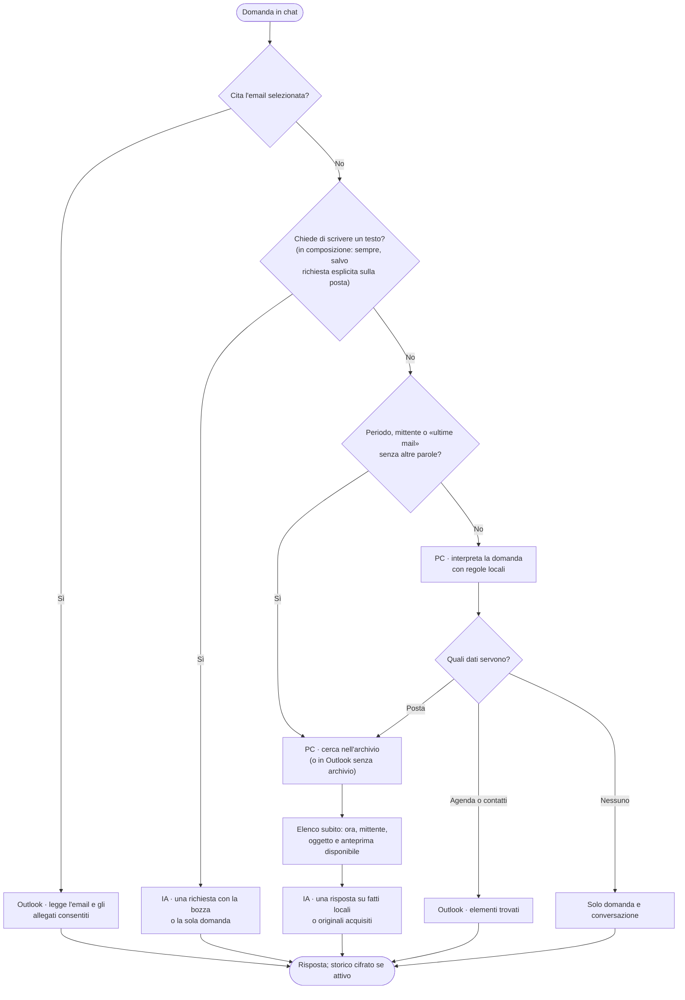

# Riquadro e azioni

Il riquadro WebView2 appartiene alla finestra Outlook che lo apre. Ogni azione usa il profilo IA attivo e le sue [autorizzazioni](modelli-web.md); nessun invio chiede conferma nel riquadro.

Gli errori del riquadro mostrano istruzioni in italiano; i dettagli delle eccezioni restano nei log. Un errore viene annunciato come tale, mentre un annullamento mantiene il proprio messaggio. Se un aggiornamento non viene visualizzato, il riquadro invita a chiuderlo e riaprirlo se resta fermo. I log si esportano da **Stato → Avanzate → Diagnostica**.

Se Storico o il flusso restano in caricamento per 15 secondi compare **Riprova**; la richiesta precedente può ancora terminare. Stato mostra profilo, modello, destinazione, errore e fase dell'archivio; indirizzo del servizio, versioni, metriche e Diagnostica stanno nella sezione **Avanzate**, chiusa all'apertura, e le tabelle strette scorrono orizzontalmente. Le cartelle non leggibili sono separate da quelle ancora da leggere; la percentuale esclude le non leggibili, mentre il totale le comprende. Gli errori indicano la cartella e invitano a verificarne l'accesso in Outlook, anche nel Cestino: ripristinala solo se necessario, senza ricreare una cartella eliminata. Lascia aperta la cassetta e attendi il prossimo controllo completo; l'errore non prova che i dati siano stati eliminati.

Se il browser del riquadro si interrompe, il pannello tenta una sola ricreazione automatica, mantenendo il lavoro e il risultato da ripristinare. Se il caricamento fallisce compare **Riprova a caricare il pannello**.

## Dove sono i comandi

| Punto | Comandi |
| --- | --- |
| Home → gruppo OnlyWorkspace (elenco o email aperta) | Sintesi, Bozza risposta…, Verifica |
| Scheda OnlyWorkspace | **Assistente**: Chat (menu Svuota chat e Storico), Interrompi · **Email**: Sintesi, Bozza risposta… (menu accetta/rifiuta), Verifica, Altre azioni (Attività e appuntamenti, Estrai dati) · **Posta e persone**: Cerca e analizza (menu dei preset, inclusa Email senza risposta), Briefing · **Sistema**: Riquadro, Configurazione, Stato (Archivio e IA) |
| Finestra di composizione (scheda Messaggio) | Scrivi con IA, Migliora (Correggi, Più formale, Più cordiale, Più breve, Più chiaro), Traduci (inglese, italiano, francese, tedesco, spagnolo), Oggetto; la scheda OnlyWorkspace resta senza il gruppo «Email» |
| Clic destro su un'email | Sintesi, Bozza: accetta / rifiuta, Verifica sicurezza, Attività |
| Solo nel riquadro | Follow-up, Rispondi (Accetta cortesemente, Rifiuta con alternativa, Con istruzione…), ⋯ (Ricostruisci la pratica, Verifica sicurezza, Attività e appuntamenti, Estrai dati) |

Tasti nel riquadro: **Alt+S** Sintesi, **Alt+R** Rispondi, **Alt+T** ⋯ (altre operazioni), **Alt+V** Verifica sicurezza, **Alt+C** Chat, **Esc** chiude un pannello o interrompe.

I menu del ribbon aprono le stesse viste del riquadro; i preset di Cerca e analizza impostano il tipo di ricerca. Stato distingue Archivio e IA.

**Quando serve selezionare un'email:** Sintesi, Rispondi, Follow-up, Verifica e le altre azioni sull'email compaiono nel blocco **Email**, con l'oggetto della selezione o dell'email aperta. Senza email il riquadro e il ribbon mostrano «Seleziona o apri un'email»; Chat, Cerca e analizza e Briefing restano disponibili. Il menu contestuale usa l'email su cui hai fatto clic destro.

Durante la scrittura, anche in una risposta inline, il riquadro mostra **Bozza** con il suo oggetto e i comandi Scrivi, Migliora, Traduci e Oggetto. Traduci lavora sul testo della bozza aperta. L'email originale che Outlook mantiene selezionata non abilita le azioni sull'email ricevuta. Se cambi email o togli la selezione mentre prepari un'istruzione di risposta, il campo torna alla Chat conservando il testo scritto; le riprove di un risultato già prodotto conservano invece la fonte originale.

## Barra del riquadro

La barra concentra marchio, navigazione e stato di archivio e IA.

La nuvola sulla risposta indica l'avvio di una richiesta a un modello cloud o a una ricerca web esterna. Le risposte prodotte interamente sul PC non attivano la nuvola, anche con un profilo cloud selezionato. Il simbolo segnala l'avvio dell'invio, senza certificare che il server lo abbia ricevuto o completato.

Durante il trascinamento del bordo il riquadro non scrive la larghezza (Outlook la rimetteva subito, in un ciclo che faceva sfarfallare e bloccava la finestra): il minimo viene ripristinato dopo il rilascio del mouse, con al più quattro tentativi per ridimensionamento. Finché Outlook mantiene una larghezza inferiore, la pagina conserva 340 pixel CSS e permette lo scorrimento orizzontale.

- **OnlyWorkspace** (icona e nome, a sinistra, sopra le sezioni): non è un pulsante; il suggerimento indica profilo, modello e server a cui vanno i dati. Il profilo è quello predefinito scelto dall'amministratore nel ConfigTool; il modello resta anche in Stato.
- **Chat · Posta · Storico**: tre sezioni con etichette sempre visibili, su una riga compatta sotto il marchio e gli indicatori. **Posta** raccoglie Cerca e analizza e Briefing. Sotto i 340 px resta solo l'icona del marchio. Le sezioni conservano filtri, risultati e operazioni; i dettagli dello stato si aprono dagli indicatori Archivio e IA.
- Indicatori **Archivio** e **IA**: pillola con badge di stato, nome e destinazione in testo («PC» per locale, «Cloud» per un servizio su internet; l'archivio è locale). Nel riquadro stretto la pillola va su due righe. Verde con spunta: esito regolare verificato; giallo con spinner: lavoro realmente in corso (passata dell'archivio, richiesta al modello); rosso con «!»: errore, con il motivo nel suggerimento e in Stato; grigio: spento o non ancora verificato (–), in pausa o bloccato dall'informativa (‖), in attesa di inattività o del prossimo ciclo (…). L'archivio si aggiorna ogni 5 secondi mentre il riquadro è visibile; l'indicatore IA cambia solo con richieste reali o con **Verifica connessione** e riparte da «non verificato» quando cambiano profilo o credenziali. Un clic apre Stato sulla sezione corrispondente; l'ingresso o l'uscita da un errore è annunciato agli screen reader. **Globo**: il profilo cerca sul web per alcune azioni, elencate nel suggerimento.
- **?** apre la guida, scritta per chi usa l'app; versione, licenza e componenti di terze parti sono in ConfigTool → Informazioni.
- Sotto la barra compare l'oggetto e una sola riga di pulsanti: con un'email selezionata **Sintesi · Rispondi · Follow-up · ⋯**, durante la composizione **Scrivi · Migliora · Traduci · Oggetto**; senza email compare l'indicazione di selezionarla. Briefing è in Posta, tra i suggerimenti della chat vuota e sul ribbon.
- Il riquadro controlla le modifiche salvate nel ConfigTool al successivo messaggio della pagina, per esempio quando avvii un’azione.
- Un cambio di destinazione o permessi dei dati interrompe il lavoro precedente. Lo storico resta leggibile; il prossimo messaggio apre una nuova chat, senza riutilizzarne i contenuti. L'avviso appare anche nelle conversazioni precedenti prive della policy registrata.

## Azioni sull'email selezionata

Ogni azione usa l'email scelta al suo avvio; **Riprova/Rigenera** resta su quella email anche se la selezione cambia. Nelle azioni sull'email selezionata il testo dell'email e degli allegati leggibili va al modello intero, salvo Appuntamenti e scadenze che usa i soli fatti locali a Minimo oppure originali ripuliti e fatti a Standard o con un profilo locale: con Ollama, se non entra nel contesto del profilo, l'azione si ferma con «Il testo è troppo lungo per il profilo in uso» e non invia nulla. Sotto il risultato di Sintesi, chat sull'email, Attività e appuntamenti ed Estrai dati il riquadro elenca gli allegati non letti con il motivo (scansione, OCR disattivato o non disponibile, password, dimensione…) con le etichette di Cerca e analizza, qualunque cosa risponda il modello, che riceve lo stesso elenco; nel Briefing il motivo compare accanto a ogni email. I profili esterni non ricevono il testo degli allegati. Sintesi, chat, analisi, Briefing e Verifica rispondono in italiano (la chat nella lingua della domanda); bozze, solleciti e traduzioni sono nella lingua dell'email o in quella chiesta, e una riga «Oggetto:» scritta dal modello non entra mai nella risposta: resta l'oggetto di Outlook.

| Azione | Cosa fa | Risultato |
| --- | --- | --- |
| **Sintesi** | Email, thread disponibile (al massimo i 20 messaggi più recenti, con il totale dichiarato) e testo degli allegati consentiti | Sintesi con Copia e Rigenera |
| **Bozza risposta** | Risposta guidata da un'istruzione o preimpostata (accetta, rifiuta con alternativa); **Modifica** rielabora la bozza intera | Testo inserito al cursore o in una nuova risposta / risposta a tutti; **mai inviato** dall'add-in |
| **Verifica sicurezza** | Ogni email (ordinaria, interna, automatica, inoltrata, PEC): mittente nel suo contesto, autenticazione dichiarata dai server, link del messaggio e degli allegati, tipo reale e macro degli allegati, lettura statica di script PowerShell/JavaScript/VBScript/batch e pagine HTML (mai eseguiti); Microsoft Defender sulle copie, attribuito a parte; poi lettura IA del contenuto con citazioni | Badge con colore, simbolo e testo: **Nessuna anomalia rilevata**, **Da verificare**, **Contenuto sospetto**, **Non verificabile**; «Controllo parziale» quando un controllo non è completo. Al massimo due motivi, un'azione e i dettagli con le citazioni. Non è un antivirus né un filtro antispam: il badge viene dalle regole locali, l'IA propone osservazioni citate senza gravità. Senza IA, al livello di esposizione 0-1 o in caso di errore resta il rapporto locale |
| **Attività e appuntamenti** | Proposte dai fatti locali a Minimo o dagli originali acquisiti negli altri profili; per una PEC legge localmente il messaggio originale | Bozze Outlook da controllare e salvare, oppure **Aggiungi a Outlook** con categoria «OnlyWorkspace» |
| **Estrai dati** | Campi e righe di documenti commerciali | Tabella copiabile o **Salva CSV in Download** (`OnlyWorkspace_dati_<data>.csv`) |
| **Follow-up** (riquadro) | Conversazione Outlook e, con l'archivio, precedenti per controparte, oggetto e riferimenti; al modello il corpo originale di un massimo di 12 precedenti, senza i loro allegati | Stato, precedenti con riferimenti [Mn] e punti da seguire |

Estrai dati e Attività e appuntamenti conservano tutte le voci valide restituite dal modello, senza tagli locali a 40 campi, 200 righe o 10 attività. Le voci non valide scartate sono indicate per quantità e motivo come **Risultato parziale**, anche negli export e nello storico. Lo storico delle estrazioni conserva anche il testo completo della tabella o elenco esportabile. Un limite di risposta del modello resta un caso distinto.

Follow-up legge i precedenti dalla conversazione Outlook e dai testi integrali disponibili nell'archivio, usando Outlook se necessario, con la stessa pulizia del corpo delle altre azioni e senza un taglio a un numero fisso di caratteri. Se un originale non è disponibile, lo dichiara nella copertura e non usa l’anteprima al suo posto. Gli allegati dei precedenti sono esclusi. Con un profilo locale, se il contesto non contiene tutti i dati selezionati, l’operazione si interrompe con un messaggio: nessun precedente viene accorciato o escluso per farlo entrare.

I controlli locali della Verifica non interrogano DNS e non convalidano crittograficamente le firme delle intestazioni. L'eventuale ricerca web è una fonte separata e può contenere informazioni di reputazione generiche: non certifica l'autenticità del messaggio. Una scansione Defender assente o fallita è dichiarata, non equivale a «pulito».

Il rapporto attribuisce a Outlook gli allegati non accessibili solo quando l'elenco è stato letto senza errori, risulta vuoto e il messaggio segnala la presenza di allegati. Nomi o metadati non leggibili e un elenco non enumerabile sono limiti di lettura, senza attribuirne la causa a Outlook. Se alcuni allegati sono visibili, il controllo non può stabilire se Outlook ne abbia bloccati altri: il caso misto resta fuori dalla rilevazione.

La Verifica mostra un esito anche se la costruzione del rapporto o la registrazione nello Storico genera un errore. I controlli già disponibili restano visibili; se la finalizzazione segnala «Risultato non conservato nello Storico», il rapporto resta consultabile nel turno corrente. **Interrompi** mantiene i controlli disponibili e chiude il turno come interrotto.

## Scrittura

Nella finestra di una nuova email, di una risposta o di un inoltro (anche la risposta nel riquadro di lettura) il riquadro offre le azioni di scrittura. L'email in scrittura non è un'«email selezionata»: Sintesi, Rispondi e le altre azioni non la leggono.

| Azione | Cosa va al modello | Risultato |
| --- | --- | --- |
| **Scrivi** (o la chat) | La richiesta, oggetto, nomi dei destinatari A e Cc, il testo già scritto e il messaggio citato di una risposta o di un inoltro; se la richiesta parla degli allegati («analizza gli allegati», «cosa dice il PDF?») anche il testo dei file allegati alla bozza, con le stesse regole dell'email selezionata: con un profilo cloud il contenuto degli allegati non esce e la risposta dice quali file non sono stati letti | Testo con **Inserisci** al cursore, **Sostituisci selezione** se c'era testo selezionato, **Copia**; se l'oggetto è vuoto, il testo propone anche «Oggetto: …» |
| **Migliora** (Correggi, Più formale, Più cordiale, Più breve, Più chiaro) | Il testo selezionato, altrimenti quanto scritto sopra la citazione | Come sopra |
| **Traduci** | Come Migliora | Come sopra |
| **Oggetto** | Quanto scritto sopra la citazione | **Usa come oggetto** |

Nessuna di queste azioni cerca nella posta o sul web. In composizione la chat aiuta a scrivere e cerca nella posta solo se la richiesta lo chiede esplicitamente («cerca nelle mail…», «cosa mi ha scritto…», «email ricevute…»). **Sostituisci selezione** scrive solo se la selezione è ancora quella inviata.

Sostituisci selezione rimpiazza il testo anche se nell'editor Word è disattivata l'opzione **La digitazione sostituisce il testo selezionato**. Se la selezione cambia durante la generazione, l'operazione viene rifiutata: seleziona di nuovo il testo da sostituire.

Fuori dalla composizione una richiesta di scrittura in chat («scrivi un'email a Rossi per…», «prepara un post…») va al modello una volta, senza ricerca nella posta: il risultato offre **Nuova email**, che apre un messaggio con oggetto e testo da completare con i destinatari. Nulla viene inviato.

## Briefing

Agenda di oggi e fino alle ultime 25 email non lette della Posta in arrivo dell'account predefinito. Il modello propone riepilogo, priorità e categorie dalle email originali ripulite oppure, a livello Minimo, dai soli fatti estratti in locale. Ogni categoria si applica solo con un clic. Al livello Minimo l'agenda resta visibile sul PC e nello Storico: soggetti, luoghi e orari degli appuntamenti non entrano nel prompt né nel contesto delle domande successive. Con un profilo Standard o locale l'agenda resta inclusa nel contesto.

Il risultato dichiara il perimetro e gli allegati non letti. Se il prompt completo non entra nel contesto locale, l'azione si ferma senza tagliare testi o togliere email dall'insieme selezionato.

## Chat

La chat generica non aggiunge l'email selezionata: per usarla va citata («riassumi questa email»).

Un riferimento esplicito a un ordine, una fattura o un protocollo cerca nei fatti dell'archivio: «Riassumi le email sull'ordine 4471» e «Cosa chiede l'email sull'ordine 4471 e chi la manda?» cercano lo stesso ordine. Le formule di richiesta non sono parole chiave; termini aggiuntivi come «ritardo consegna» continuano a restringere la ricerca. Senza archivio disponibile il riquadro segnala che non può applicare questi filtri.

I filtri espliciti come «trova le email ordine ORD-2026/118», «importo >=1000,01 EUR» o «scadenza entro 2026-11-30» sono interpretati localmente e richiedono l'archivio. La ricerca espande le catene correlate e segnala i messaggi fuori dai filtri iniziali, conservando una copia per Message-ID; la risposta può ancora richiedere il modello. Le espressioni ambigue non diventano filtri numerici o date inventate.

Le domande sulla posta per periodo («della mattina», «di ieri pomeriggio», «ultimi 3 giorni», «settimana scorsa»), per mittente («da Rossi», «di bioferspa.com») o sulle «ultime 5 mail» sono interpretate sul PC; anche le altre passano dalla classificazione locale. La posta si cerca nell'archivio: le email arrivate negli ultimi minuti e le cassette escluse dall'archivio si leggono da Posta in arrivo e Posta inviata di Outlook. L'elenco compare prima di qualunque chiamata al modello; se occorre, il modello scrive il resoconto in una sola richiesta, usando fatti locali a Minimo oppure originali ripuliti a Standard e con profili locali. Gli allegati entrano solo se richiesti e consentiti; i profili esterni ne escludono il testo. Le schede IA pregresse non sono usate. La ricerca web parte solo per le domande generali o quando la domanda la chiede («sul web», «online», «notizie»), entro le autorizzazioni del profilo. I turni precedenti possono essere ridotti per lasciare spazio ai dati correnti.

L’intento è classificato sul PC, senza inviare la domanda al modello: posta, agenda, contatti, scrittura e domande generali. Le regole conservano periodi, nomi, mittenti, codici e termini citati; le espressioni non riconosciute restano indizi di ricerca. Non rappresentano una comprensione completa dei filtri. Le domande che nominano la PEC passano all'interpretazione generale: quando il filtro di cassetta non è disponibile, la chat lo dichiara e rimanda a [Cerca e analizza](cerca-analizza.md), dove puoi selezionare la cassetta.

## Interrompi, Riprova, Rigenera

- **Interrompi** (ribbon, barra di avanzamento, Esc o Invia) ferma l'operazione corrente. Cerca e analizza e Appuntamenti e scadenze, dopo almeno un'email letta, si chiudono con quanto letto salvato nello storico, senza inviare la richiesta al modello (o fermandola se è già partita); le altre azioni con «Operazione annullata.». Interrompi del ribbon ferma il lavoro della sua finestra o, se lì non c'è nulla in corso, quello delle altre finestre di Outlook.
- Avviare un'altra azione sostituisce la precedente («Operazione sostituita.»).
- Cambiare pagina non perde il lavoro: su un'altra pagina la barra in basso mostra l'operazione in corso con **Mostra** e **Interrompi**; tornando, Cerca e analizza conserva il modulo lanciato e Stato l'esito della verifica. Un'operazione avviata nel riquadro di un'altra finestra di Outlook (un'email aperta a parte) compare nella barra come «Nella finestra di un'email: …» e si può interrompere da lì; chiudere quella finestra la annulla. Se la pagina del riquadro si ricarica, l'operazione in corso ricompare con il testo già ricevuto.
- **Riprova** (dopo un errore ripetibile) e **Rigenera** (dopo un risultato) ripetono l'azione con profilo e autorizzazioni attivi in quel momento. Per una domanda sulla posta in chat e per Cerca e analizza, Riprova riusa per 15 minuti le email e i risultati web già letti, senza cercarli e leggerli di nuovo, se la richiesta, la conversazione e la politica dei dati del profilo non sono cambiate; altrimenti, e per Rigenera, l'azione riparte da capo. Riprova non compare se il testo non entra nel contesto o l'email non è più disponibile.
- Una richiesta già ricevuta dal provider non può essere ritirata.

Il riquadro ripristina il turno in corso dopo un ricaricamento senza duplicarlo. Per gli esiti sulla build installata vedere [Verifica e qualifica](../tecnico/verifica.md).

## Storico, Riprendi, Svuota chat

**Storico** conserva cifrati per utente chat e risultati delle azioni (default 90 giorni, 200 conversazioni). Ogni richiesta salva l'email a cui appartiene (oggetto, mittente, data; per un'email in scrittura solo l'oggetto): nella conversazione compare sotto la richiesta e un clic la apre in Outlook; nell'elenco dello Storico compare sotto il titolo. **Riprendi** riapre la conversazione e la prossima domanda la continua; le bozze di risposta ritrovano **Inserisci bozza** sull'email originale. Una conversazione fatta con un altro profilo prosegue in una nuova conversazione con il profilo attivo, e il riquadro lo dice. **Svuota chat** (menu Chat nel ribbon, o cestino colorato accanto a Invia) apre una conversazione vuota senza conferma; quelle salvate restano nello Storico. Nel riquadro il cestino è disabilitato quando la chat è vuota o durante il lavoro; anche nel ribbon è disabilitato senza conversazione o durante il lavoro, con una protezione aggiuntiva nell’host. Eliminare dallo Storico resta un’azione distinta. Il profilo attivo è sempre il predefinito scelto nel ConfigTool; al riavvio di Outlook il riquadro riparte dalla chat vuota.

Codice: [RibbonXml](../../src/OnlyWorkspace.Outlook/Ribbon/RibbonXml.cs), [TaskPane.html](../../src/OnlyWorkspace.Outlook/UI/TaskPane.html), [TaskPaneCoordinator](../../src/OnlyWorkspace.Outlook/UI/TaskPaneCoordinator.cs), [scrittura](../../src/OnlyWorkspace.Outlook/UI/TaskPaneCoordinator.Compose.cs), [ChatWriting](../../src/OnlyWorkspace.Core/Context/ChatWriting.cs), [FollowUpCoordinator](../../src/OnlyWorkspace.Infrastructure/Llm/FollowUpCoordinator.cs). Prompt: [prompts](../../prompts).

**Aggiungi a Outlook** mostra «Salvataggio…» durante l’attesa. Una voce diventa «Aggiunta» solo dopo la conferma di Outlook; in caso di errore resta riprovabile con il motivo. In un salvataggio multiplo le voci riuscite restano distinte da quelle fallite.
